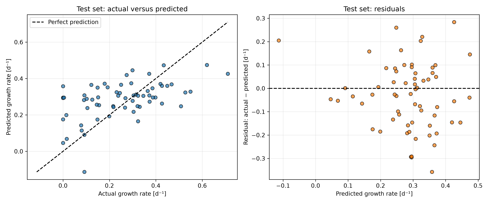
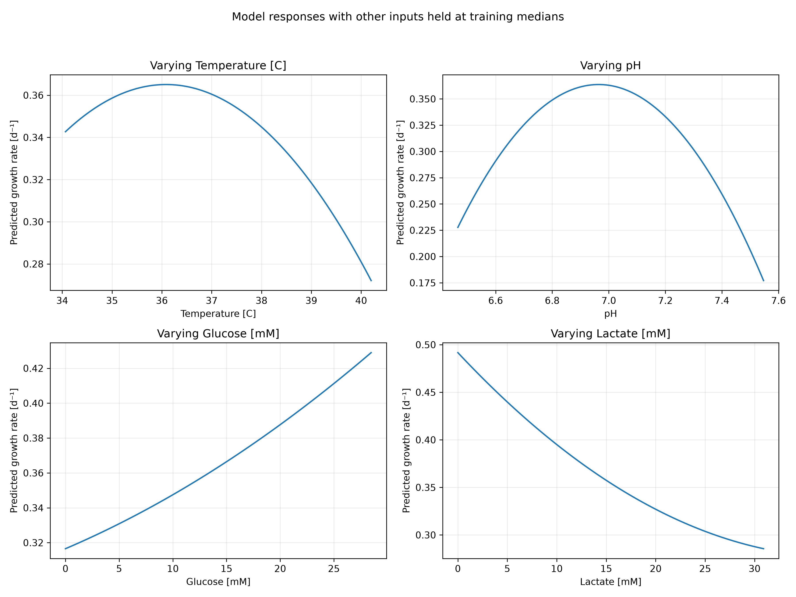

# Cell Growth Predictor

Cell Growth Predictor uses temperature, pH, glucose concentration, and lactate concentration to estimate specific cell growth rate from simulated culture data. 
It compares polynomial and k-nearest neighbors regression through cross-validation, evaluates the selected model on reserved test observations, and exports figures and tables. 
The project explores relationships between culture conditions and growth while documenting prediction errors and limitations.

## Highlights

- Build reproducible regression workflows with scikit-learn.
- Compare fourteen baseline and regression configurations.
- Prevent scaling leakage using preprocessing pipelines.
- Evaluate predictions using reserved test observations.
- Visualize model responses and prediction limitations.

## Environment

- Python 3.14.7
- Matplotlib 3.11.0
- NumPy 2.5.2
- pandas 3.0.5
- scikit-learn 1.9.0

The program also uses `pathlib`, which is part of Python’s standard library. The installed environment is recorded in `environment.yaml`.

## Code Design

### Program Entry Point and File Organization

The program starts when `main.py` is executed. This file imports and calls `run_workflow()` from `src/functions.py`, where the analysis is organized as a sequence of stages. Keeping the entry point short separates the command that starts the program from the implementation of the workflow. The program uses `pathlib` to locate the project directory relative to the source file. Dataset and output paths therefore refer to the project folders rather than depending on the terminal’s current directory.

### Data Loading and Initial Inspection

The workflow loads `dataset_cell_growth_4factor.csv` into a pandas DataFrame. Each row contains four culture conditions and an associated specific growth rate. Initial checks print the dataset dimensions, column names, data types, missing-value counts, duplicate-row count, and summary statistics.

These checks help establish whether the supplied data can be used by the regression models. The dataset contains 318 observations, five numeric columns, no missing values, and no exact duplicate rows. Consequently, no imputation or duplicate removal is applied. The inspection reports potential data-quality issues; it does not automatically repair them. This stage also confirms the column names used later to select inputs and the prediction target.

### Input Selection and Reserved Test Data

Temperature, pH, glucose concentration, and lactate concentration form the input matrix. Specific growth rate is stored separately as the target. Separating these quantities prevents the known answer from being supplied to the model as an input.

The observations are randomly divided into 254 training observations and 64 test observations. A fixed random seed makes the split reproducible. Model selection uses only the training portion, while the test portion is reserved for evaluating the chosen model. This separation reduces the risk of selecting a model because it happens to perform well on the final evaluation examples. The random split assumes observations are sufficiently independent; it does not establish performance on a different experimental campaign or cell type.

### Cross-Validation and Preprocessing

Five-fold cross-validation divides the training observations into five groups. Each group serves as validation data once, while the remaining four groups are used for fitting. Every candidate uses the same shuffled folds, making comparisons consistent across models.

Regression models use pipelines to combine standardization with fitting. Standardization expresses each input relative to its training mean and standard deviation. This is particularly important for KNN because its distance calculations would otherwise be influenced by the different numerical scales of temperature, pH, and concentrations. The pipeline fits the scaler separately within each training fold, preventing validation observations from influencing its scaling parameters.

### Candidate Models and Selection

A mean-predicting baseline establishes a reference level of performance. Linear regression provides a simple model of additive linear relationships. Polynomial models of degrees two and three add powers and interactions, allowing curved responses and relationships involving multiple inputs. Both polynomial candidates use ordinary least-squares regression.

KNN models are evaluated with 3, 5, 10, 15, and 25 neighbors, using both uniform and distance-based weighting. They use Euclidean distance after standardization. Together with the baseline and polynomial candidates, this produces fourteen configurations.

The workflow compares mean validation RMSE, MAE, and R². RMSE is the primary selection measure because it penalizes larger errors more strongly. Degree-two polynomial regression achieved the lowest mean validation RMSE among the tested configurations. That selected architecture is explicitly specified in the final-model stage. The comparison table is exported to document the evidence supporting this choice.

### Final Fitting and Test Evaluation

The selected pipeline is fitted using all 254 training observations and then predicts growth rates for the 64 reserved test observations. The program calculates test RMSE, MAE, and R² and exports them to `test_metrics.csv`. Individual inputs, observed growth rates, predictions, and residuals are saved in `test_predictions.csv`.

Residuals are calculated as observed minus predicted growth rate. An actual-versus-predicted plot shows agreement with an ideal prediction line, while a residual plot displays the direction and magnitude of errors. These outputs help assess model limitations that a single average metric could conceal. Predictions are reported without clipping negative values, making the unconstrained polynomial model’s behavior visible.

### Interpretation and Exported Evidence

The workflow explores each input by varying it across its training-data fifth-to-ninety-fifth percentile range while holding the other inputs at their training medians. The resulting curves describe conditional model responses, rather than causal biological effects or averages over all observations. Their input combinations and predictions are exported alongside the figure.

The program also saves five high-growth and five low-growth training examples, plus input minima, percentiles, medians, and maxima. These tables support discussion of observed culture conditions and the limits of the training data. Figures are saved in `figures`, tables in `tables`, and each figure is closed after saving. Together, these outputs provide reproducible evidence for the model comparison, performance assessment, and interpretation.

## Analysis

### Model Selection and Architecture

The selected model is degree-two polynomial regression, implemented as a pipeline containing input standardization, polynomial feature generation, and ordinary least-squares linear regression. The four original inputs are temperature, pH, glucose concentration, and lactate concentration. Degree-two expansion produces fourteen terms: four original inputs, four squared terms, and six pairwise interactions. `include_bias=False` avoids generating a constant column because the regression estimator already fits an intercept.

This architecture can represent curved responses and interactions while remaining relatively compact. For example, squared temperature and pH terms allow predictions to rise and then fall across an input range. Interaction terms allow the fitted effect of one variable to depend on another. These capabilities are useful for this dataset because the degree-one model had substantially higher validation error. However, the polynomial form is an approximation learned from simulated observations, not a mechanistic description of cell growth.

The polynomial degree was selected by comparing degrees one, two, and three. All polynomial models used ordinary least squares without regularization, so no regularization strength was tuned. Degree two achieved the lowest mean validation RMSE among the fourteen configurations evaluated. This supports its selection within the tested candidates, but does not establish that it is the best possible model.

### Comparison with Alternative Models

The table below summarizes representative results from five-fold cross-validation on the 254 training observations. All candidates used the same folds. RMSE and MAE are expressed in d⁻¹; lower values indicate smaller errors. Higher R² indicates better predictive performance relative to the validation-set mean reference.

| Model | Mean validation RMSE | Mean validation MAE | Mean validation R² |
|---|---:|---:|---:|
| Mean baseline | 0.1932 | 0.1579 | -0.0145 |
| Linear regression | 0.1804 | 0.1497 | 0.1128 |
| Polynomial degree 2 | 0.1592 | 0.1288 | 0.3022 |
| Polynomial degree 3 | 0.1648 | 0.1340 | 0.2614 |
| KNN: 15 neighbors, distance weighting | 0.1619 | 0.1351 | 0.2857 |
| KNN: 25 neighbors, distance weighting | 0.1625 | 0.1370 | 0.2812 |
| KNN: 3 neighbors, uniform weighting | 0.1686 | 0.1404 | 0.2139 |

[Full comparison of fourteen configurations](tables/model_comparison.csv)

The baseline always predicts the fitting subset’s mean growth rate. Its slightly negative mean validation R² is possible because that mean differs from the mean of the corresponding validation subset. Linear regression reduced RMSE modestly, showing that additive linear relationships captured some information. Degree-two polynomial regression reduced mean validation RMSE by approximately 17.6% relative to the baseline and 11.8% relative to linear regression.

Increasing polynomial degree did not improve validation performance. Degree three lowered training RMSE from 0.1460 to 0.1340 d⁻¹, but increased validation RMSE from 0.1592 to 0.1648 d⁻¹. This pattern suggests that the additional flexibility fitted training-specific variation without improving predictions on held-out folds. Degree three generates thirty-four terms, compared with fourteen for degree two, making degree two a more economical choice for the observed results.

KNN was a competitive alternative. It predicts using nearby observations rather than fitting a single global polynomial relationship. The comparison included five neighborhood sizes and two weighting methods, with standardized inputs and Euclidean distance. The best tested KNN configuration used fifteen neighbors and distance weighting. Smaller neighborhoods can respond to local patterns but are also sensitive to individual observations. Larger neighborhoods smooth predictions across more examples.

The selected polynomial model’s RMSE advantage over the best KNN configuration was only about 0.0027 d⁻¹. This is a small difference. Fold-level uncertainty and repeated cross-validation were not assessed, so the results do not demonstrate a statistically decisive advantage. The same folds were also used to compare and select configurations, making the winning validation score potentially optimistic. The reserved test set provides a separate assessment of the selected model.

### Performance on Reserved Test Observations

After selection, the degree-two pipeline was fitted on all 254 training observations and evaluated on the 64 reserved test observations. The model settings were not changed in response to the test results.

| Test metric | Value |
|---|---:|
| RMSE [d⁻¹] | 0.1455 |
| MAE [d⁻¹] | 0.1173 |
| R² | 0.2214 |

[Exported test metrics](tables/test_metrics.csv)

The MAE indicates an average absolute prediction error of 0.1173 d⁻¹ across these test observations. RMSE is larger because it gives greater weight to larger errors. Test R² of 0.2214 indicates that substantial variation remains unexplained. This value is not a percentage accuracy score.

Test RMSE was lower than mean cross-validation RMSE, while test R² was also lower. These results are not contradictory: RMSE measures error in growth-rate units, whereas R² also depends on variation in the evaluation targets. Additionally, the cross-validation results average scores from five separate subsets. Differences between these measures should therefore not be interpreted as evidence that one evaluation is uniformly better.

The prediction plot shows that many low observed growth rates are overpredicted and the highest observed rates are underpredicted. Predictions often lie nearer the middle of the observed range. At least one test prediction is negative even though the supplied target values are nonnegative. This exposes a limitation of unconstrained polynomial regression for this dataset. The results support using the model as an exploratory predictor with meaningful uncertainty, rather than as a precise representation of every culture condition.

### Predicted Relationships Between Culture Conditions and Growth

The response curves show how the fitted model behaves when one input varies while the other three remain at their training-data medians. The reference conditions are 36.8 °C, pH 7.015, 13.95 mM glucose, and 14.3 mM lactate. Each input varies between its fifth and ninety-fifth training percentiles. These curves describe the model at particular reference conditions; they are neither experimental proof of causation nor average effects across the dataset.

Temperature has a curved predicted relationship with growth, with a peak near 36 °C under the reference conditions. Predicted growth decreases toward the warmer end of the plotted range. The pH response also has a peak, near 7.0, with lower predictions on either side. These shapes show why quadratic terms can be useful compared with a purely linear model. However, the estimated peaks should not be interpreted as universally optimal operating conditions.

Predicted growth increases with glucose over the plotted range, while it decreases with lactate. These patterns summarize relationships learned from this simulated dataset. The glucose curve does not establish that increasing glucose indefinitely would improve growth, nor does the lactate curve establish a causal effect. Polynomial behavior outside the investigated range may differ substantially from realistic culture behavior.

The model includes interaction terms, so changing the reference conditions can change these response curves. In particular, the apparent temperature peak at fixed median conditions need not match the temperatures associated with the highest observed growth rates. Observations vary across all four inputs simultaneously, whereas each curve changes only one.

### Biological Context for the Model Responses

The four inputs represent conditions that can affect cellular metabolism and proliferation. The following experimental examples provide biological context, but they do not identify the cell type or mechanisms used to generate this simulated dataset.

**Temperature:** Temperature affects the rates of cellular processes and can change the balance between proliferation and product formation. In one CHO-cell study, reducing temperature from 37 to 33 °C reduced growth while increasing cell-specific protein production. Thus, conditions that maximize growth need not maximize productivity. Our model’s temperature peak is an empirical prediction at fixed reference conditions, not a universal biological optimum. [Experimental temperature study](https://www.sciencedirect.com/science/article/abs/pii/0141022995001212)

**pH:** Culture pH influences metabolism and the conditions cells must maintain internally. Experimental CHO cultures showed that pH control altered glucose consumption and lactate production, demonstrating that these variables are interconnected. The model’s predicted peak near pH 7 should therefore be interpreted in the context of the other inputs rather than as an independently established optimum. [Experimental pH study](https://pubmed.ncbi.nlm.nih.gov/27453130/)

**Glucose:** Glucose supplies carbon and energy for cellular activity. Insufficient availability can limit proliferation; a CHO-cell study reported growth arrest following glucose depletion. This provides context for the model’s increasing response to glucose over the plotted range. It does not imply that unlimited glucose addition would continuously improve growth. [Experimental glucose study](https://www.sciencedirect.com/science/article/pii/S0168165606002471)

**Lactate:** Lactate is linked to glucose metabolism and can accumulate as a byproduct. Its relationship with growth is context-dependent: experimental CHO cultures have demonstrated simultaneous glucose and lactate consumption. Therefore, the model’s decreasing response to lactate summarizes this dataset rather than proving that lactate always inhibits growth. The interaction between nutrient availability, pH, and metabolic state limits conclusions based on one concentration alone. [Experimental glucose–lactate study](https://www.sciencedirect.com/science/article/pii/S1369703X19302955)

### Examples of High- and Low-Growth Conditions

The table below presents selected training observations. These are observed examples from the simulated dataset, rather than operating conditions created by optimization.

| Example | Temperature [°C] | pH | Glucose [mM] | Lactate [mM] | Observed growth rate [d⁻¹] |
|---|---:|---:|---:|---:|---:|
| High growth | 37.8 | 7.11 | 24.8 | 0.0 | 0.750 |
| High growth | 38.3 | 7.12 | 27.3 | 5.8 | 0.750 |
| High growth | 37.1 | 7.01 | 32.6 | 0.0 | 0.750 |
| Low growth | 33.0 | 6.40 | 15.4 | 5.4 | 0.000 |
| Low growth | 37.1 | 7.56 | 11.5 | 6.2 | 0.000 |
| Low growth | 37.9 | 6.62 | 4.3 | 14.2 | 0.000 |

[All ten high- and low-growth examples](tables/growth_condition_examples.csv)

Across the five exported high-growth examples, temperatures range from 37.1 to 38.6 °C, glucose from 20.7 to 32.6 mM, and lactate from 0 to 5.8 mM. Their pH values range from 6.73 to 7.12. These observations associate high growth with relatively abundant glucose and low lactate in those particular combinations.

Low-growth examples occur under several different combinations. Some include pH values well away from 7, while others combine low glucose with appreciable lactate. The examples do not identify a single condition that explains every low-growth observation. They also do not establish thresholds separating successful and unsuccessful cultures. Repeated target values of zero and 0.750 d⁻¹ are visible, but the dataset alone does not establish whether these boundaries arose from clipping or another simulation rule.

### Reliability, Advantages, and Limitations

The training data span the following individual input ranges:

| Input | Minimum | Maximum |
|---|---:|---:|
| Temperature [°C] | 30.0 | 42.0 |
| pH | 6.0 | 7.8 |
| Glucose [mM] | 0.0 | 39.9 |
| Lactate [mM] | 0.0 | 40.0 |

[Training ranges and percentiles](tables/training_input_ranges.csv)

Predictions outside these ranges are extrapolations and require particular caution. Being inside every individual range does not guarantee reliable predictions: a combination of otherwise familiar values may still be poorly represented. The central-percentile response plots reduce exposure to individual extremes but do not verify that every plotted combination has nearby training observations.

Advantages of the selected approach include a compact architecture, reproducible evaluation, and the ability to represent curvature and pairwise interactions. Preprocessing occurs within each validation fold, and the reserved test set provides an assessment separate from model selection. Exported tables and figures make both the comparison and the model’s weaknesses inspectable.

Limitations include the small dataset, modest test R², unconstrained predictions, and dependence on a single random train-test split. The reported cross-validation averages do not quantify uncertainty in the ranking of similar candidates. Furthermore, a global quadratic relationship may miss more complex responses. Only four inputs are available, and the model cannot account for unrecorded influences.

The data are simulated. Performance on this dataset does not establish accuracy for real cultures, different cell types, or different measurement systems. The model also does not provide prediction intervals. Any future model revision should be evaluated with an appropriate validation design and fresh independent evidence, rather than repeatedly tuned against the existing test results.

### Potential Applications and Further Development

The model could serve as an exploratory tool for comparing candidate culture conditions within the supported data region. Its response plots can help generate hypotheses about combinations worth investigating, while its error analysis demonstrates where predictions should be treated cautiously. It could also support a preliminary screening workflow in which predictions guide further investigation rather than replace measurements.

Before practical use, the approach would need validation against relevant experimental data and assessment of acceptable prediction error for the intended application. Further development could examine regularized polynomial regression, additional informative inputs, and methods that respect target constraints. Repeated validation and uncertainty estimates would help determine whether apparent improvements are robust. These are future extensions, not capabilities demonstrated by the current program.